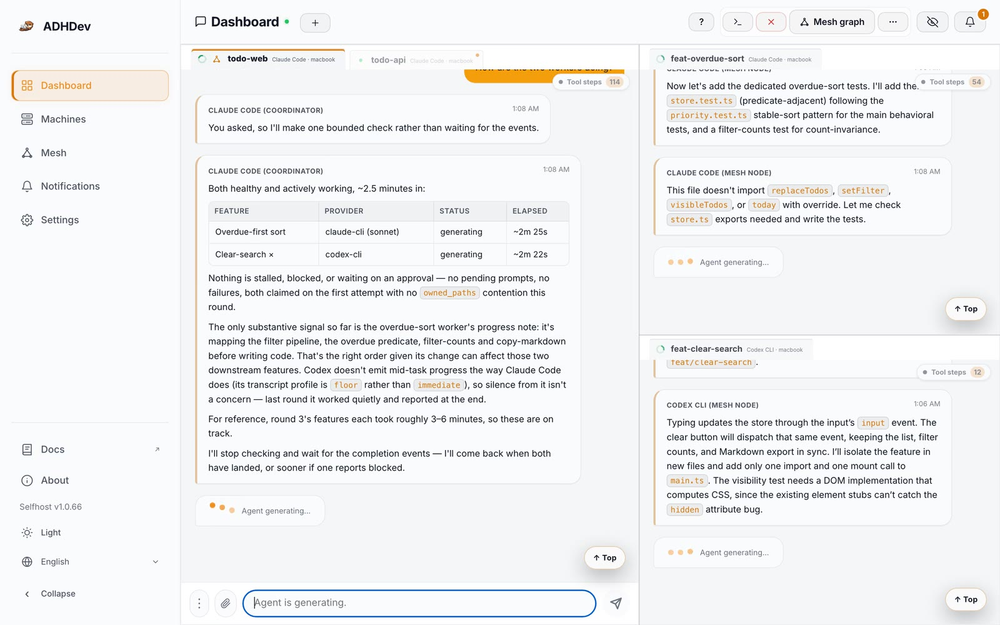
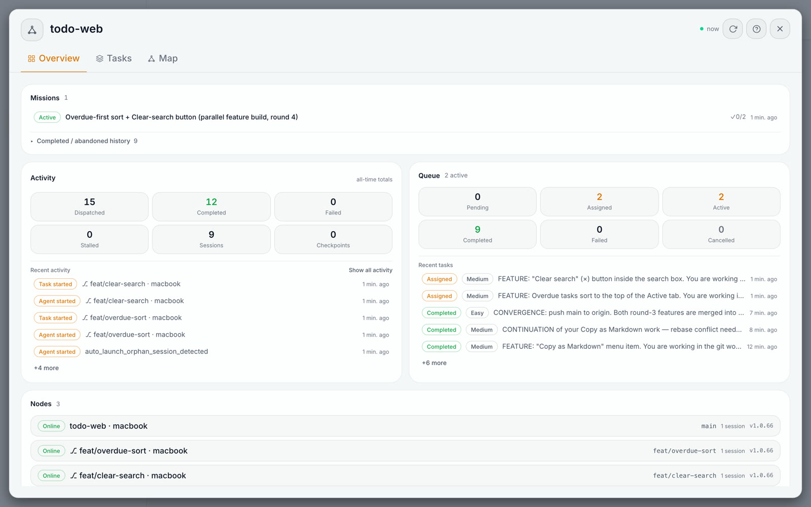
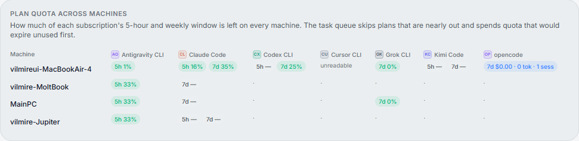
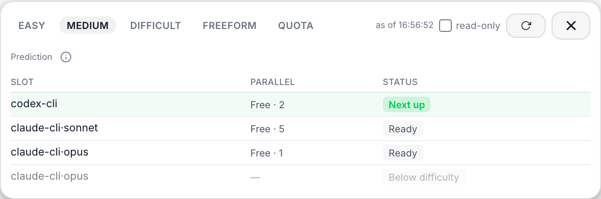
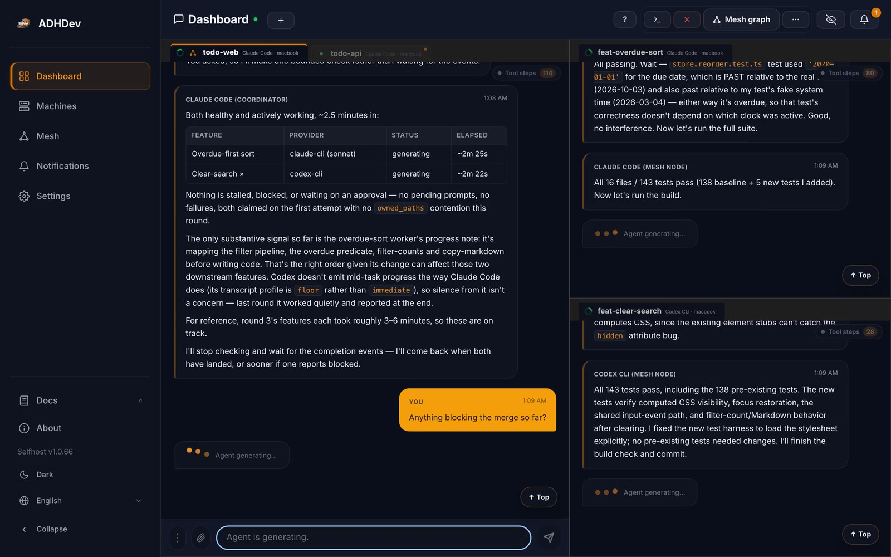
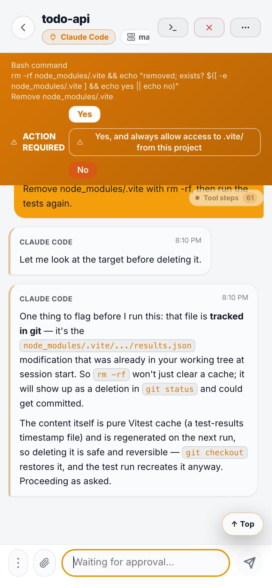
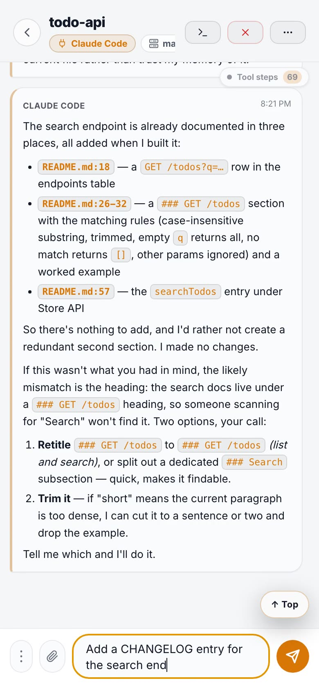

[English](README.md) | [한국어](README.ko.md) | [日本語](README.ja.md) | [简体中文](README.zh-CN.md) | [Español](README.es.md)

# ADHDev

**编码代理的控制平面：所有机器上的所有代理集中在一个视图里，共用一个任务队列，只有通过你的测试的工作才会进入 `main`。**

[](https://github.com/vilmire/adhdev/stargazers)
[](https://www.npmjs.com/package/adhdev)
[](https://www.npmjs.com/package/@adhdev/daemon-standalone)
[](https://github.com/vilmire/adhdev/actions)
[](LICENSE)

AI 编码代理已经成为长时间运行的后台工作者。ADHDev 就是它们的控制平面：在网页或移动端仪表盘上启动、观察、批准并引导代理会话——Claude Code、Codex、Kimi、Cursor CLI、Antigravity CLI、Grok CLI、OpenCode 并排运行，覆盖你拥有的每一台机器——并把收敛工作交给一条无人值守的流水线，由它把完成的工作合并进 `main`。

**并行的代理，不再互相冲突。** 每个任务都在自己的 git worktree 中运行；Refinery 对完成的工作进行把关、验证，并变基到 main，只有在 main 没有变动时才合并——不会留下合并日的宿醉。

网站：**[adhf.dev](https://adhf.dev)** · 文档：**[docs.adhf.dev](https://docs.adhf.dev)**

**一条命令试用：** `npx @adhdev/daemon-standalone`，然后打开 http://localhost:3847。

<p align="center">
  
</p>

**这个循环：** 在聊天中描述任务 → 协调器登记、打标签并入队 → 空闲的机器把它领到一个全新的工作树中 → 你的仓库自己的关卡来裁定 → 变基到 `main`，且只有在 `main` 没有变动时才合并，工作树随即消失。只有需要批准时，你的手机才会震动。

ADHDev 就是这样构建的。在开发 ADHDev 的私有单体仓库中（这个引擎作为子模块从那里发布），大约每六个 `main` 提交中就有一个是 `Auto-merge via Refinery` 提交：由代理完成、仓库自己的关卡批准、并由 Refinery 落地的工作，全程没有人手动运行 `git merge`。这段历史位于上游单体仓库中，所以这个公开镜像自己的日志里看不到这些合并提交。

---

## 为什么选择 ADHDev

### 🕸️ Repo Mesh——真正的多机并行
（单机 mesh 完全在本地运行；要扩展到多台机器，需要云端版。）把带依赖关系的任务入队，由协调器分派给任何有空闲容量的节点——你的笔记本、台式机、构建机。这是基于 P2P mesh 的真正多机编排，**不是**通过 SSH 登录到某一台主机。每个任务都在自己的工作树中运行，代理之间不会互相干扰。mesh 和 Refinery 引擎包含在本仓库中；跨机器分派运行在云端版上。

一个 mesh 绑定到一个 git 仓库，并接管那些原本需要你手动协调的环节：

| | |
| --- | --- |
| **任务队列** | 拉取式。`pending → assigned → completed/failed`，支持 `depends_on` 排序和重试。空闲节点自己领取工作——没有会失去同步的推送式调度器。 |
| **任务群（Mission）** | 把许多任务归在一起的目标，这样重启后的协调器可以接着上一个协调器的进度继续，而不是把所有任务重新入队。 |
| **工作树节点** | 每个并行任务一份隔离的分支检出，在向它分派任何工作之前自动完成引导（安装、原生模块重建、被 gitignore 的构建产物）。 |
| **仅追加的账本** | 每一次分派、完成、失败、停滞和检查点，都作为仅追加的记录写入 mesh 的本地 SQLite 存储——这是让“究竟发生了什么”事后可查的审计轨迹。 |
| **运行笔记** | 运行时记录的经验（某个提供商的怪癖、某个恢复流程）会被注入此后每一个协调器的提示词，让知识比学到它的那个会话活得更久。 |
| **实时状态提示词** | 协调器的系统提示词不是静态文本——启动时它是 mesh 实时状态（节点健康度、活动中的任务群、近期失败、累积的笔记）的渲染结果，运行时事件会被注入它的会话，而不是让它去轮询。 |
| **难度 + 配额路由** | 给任务标上 easy / medium / difficult，对应该难度的节点槽位（提供商、模型、思考级别、并行上限）就会接手，这样日常工作跑在便宜的模型上，只有困难任务才动用昂贵的模型。每台机器还会读取每个 CLI 订阅剩余的 5 小时和每周窗口：快用完的套餐会被跳过（任务等待，或转到该节点的下一个提供商），在其余的套餐中，会优先消耗在下次重置时将白白过期的配额。在任何任务运行之前，你都可以在仪表盘中看到按难度划分的路由预测。 |
| **任务链** | 用 `depends_on` 串联任务：依赖方会等待其前置任务完成，然后以“Upstream results”附录的形式收到它们的完成摘要。失败或被取消的前置任务会挂起（或按 mesh 策略取消）下游的链，并通知协调器。`mesh_enqueue_batch` 在一次原子调用中把多个已确认的任务入队。 |

<p align="center">
  
</p>

### 📊 感知配额的路由——用掉你已经付费的订阅
每台机器都会读取每个 CLI 订阅的 5 小时和每周窗口还剩多少。任务被领取时，快用完的套餐会被跳过（任务等待，或转到该机器的下一个 CLI），在其余的套餐中，会优先消耗在下次重置时将白白过期的配额。“机器”页面把整个机群放在一张网格里，mesh 的 Tasks 标签页则会在任何任务运行之前，预测每个难度下由哪个槽位接手下一个任务。

<p align="center">
  
</p>
<p align="center">
  
</p>

### 🚢 Refinery——无人值守地落地到 `main`
并行只有在工作真正合并时才有价值。Refinery 通过按仓库配置的验证关卡、补丁等价性检查、支持子模块的变基与合并（仅在 main 没有变动时）以及自动清理工作树，无人值守地让完成的任务收敛。代理完成工作，Refinery 负责落地。上面的 mesh 看板实时呈现这条流水线：在队列中流转的任务、收敛进行中的 refine 作业，以及动态流中的每一次分派、完成和停滞。

### 🧩 支持子模块的收敛——适用于真实的单体仓库
一旦涉及 git 子模块，并行工作树和无人值守合并就会变得脆弱。ADHDev 正面处理这种情况——这个项目本身就是一个子模块单体仓库（一个根仓库，加上作为子模块的 AGPL 引擎和提供商目录），我们每天都在它上面自用 mesh 和 Refinery。Refinery 在收敛过程中把子模块当作一等公民：

- **可达性关卡**——根分支落地到 `main` 之前，会验证所引用的子模块提交可以从该子模块的 `origin/main` 到达；如果不能，任务会被作为受阻保留，直到这些提交被发布。
- **补丁等价性检测**——当某个子模块提交被变基或压缩而 SHA 发生变化时，Refinery 仍会判断*内容*是否已经落地，因此不会重复合并，也不会误报分歧。
- **原子的指针更新**——子模块指针的更新与根仓库的变更一同收敛，所以无人值守的合并不会让根仓库指向损坏或悬空的子模块提交。

### ⚡ 天生异步——你只和一个地方对话
你只和一个地方对话。协调器异步地编排每一个工作者和每一台机器——等待事件的是它，不是你。无需看守会话。你不必坐在每个代理窗口前盯着它是否完成，而是把工作交给唯一的协调器，由它并行驱动所有工作者，只在完成、批准或状态事件真正到来时才作出反应——没有轮询，也没有阻塞等待。对你来说是一场对话，底层是一个非阻塞的事件循环。

### 🌐 查看并引导每一个会话
你的代理在本地运行；你可以从任何浏览器观看并操作它们。仪表盘是一个真正的控制界面：查看活动会话、读取聊天和终端状态、批准或中断工作、重新打开正确的历史记录，并从浏览器或手机发送下一条指令。无需守着终端。批准推送会带上命令本身的开头部分，因为批准 `rm -rf build/` 和批准 `git push --force` 值得不同的反应时间：推送到达 → 点按 → 一键批准（推送到手机随云端版提供）。

<table>
  <tr>
    <td width="50%" align="center" valign="top">
      
    </td>
    <td width="50%" align="center" valign="top">
      
    </td>
  </tr>
</table>

会话还可以把工作区中的文件作为**产物（artifact）**放入聊天——Markdown、图片、diff、JSON 和文本，可内联预览，并按需打开、复制或下载。文件绝不会离开已注册的工作区。

### 🛡️ 保持收敛的审批
- **自动批准只会按下一次性选项。** 开启自动批准后，守护进程会用单次的“yes”回答工作者的权限提示——绝不会选择“always”“不再询问”，也不会授予会话级或项目级的权限。
- **代理自己的按钮，放在收件箱里。** 待处理的请求会显示提供商真实的选项，范围最窄的在前，长期授权放在最后并加以标注。
- **被委派的工作者先问它们的协调器。** 工作者的权限请求先发给协调器；只有一分钟后仍无人应答，你才会收到推送。
- **只有活跃的提示才算数。** 代理只是打印出来、引用的或已经滚出屏幕的审批文字，绝不会被当作真正的提示；对已经变化的请求所作的选择会被拒绝，而不是被应答。

### 🧑‍💼 跟进你项目的助手
从仪表盘启动一个助手，并告诉它你关心的项目。它会把每个项目的报告和通知转发给你，每天总结一次已完成什么、被什么阻塞、什么需要你处理（默认为当地时间 09:00），并标出三天没有动静的任务群。需要你做决定时，它会提供几个可以点按的选项按钮；它代你执行的每一个操作都会等待你的选择。它适用于任何助手 CLI，能在重启后记住你最近的几次请求，并且——在你于另一台机器上允许之后——可以跟进托管在你另一台机器上的项目，而无需在本地检出。

### 🔺 多视角评审
对于重要的只读调查——bug 的 RCA、设计评审、审计——可以向协调器请求第二意见：它会把同一个问题发给 2–3 个使用不同提供商的工作者，等待它们的报告，然后列出它们在哪些地方一致、在哪些地方不一致，以及哪些论断只有其中一个提出。高度一致并不等于正确——同一个模型在同样的上下文下会重复同样的错误——所以真正值得读的是分歧的部分。

### 🔐 P2P 传输（出于信任，而不是付费墙）
聊天、命令、截图和远程输入通过加密的 WebRTC 数据通道，直接在你的仪表盘和你的守护进程之间传输。服务器负责登录、信令和轻量的元数据，外加一个刻意的例外：在云端版中，它会接收批准提示（命令和按钮标签）用来生成推送通知，推送最多显示其中 80 个字符。聊天、终端输出和你的代码不会放在别人的服务器上。这是设计上的信任属性，不是增值销售。

当网络迫使仪表盘连接走 TURN 中继时，ADHDev 会在后台持续寻找直连路径，并且只有在新路径经过验证、仪表盘已经切换过去之后才会切换，因此切换不会中断会话。

### 📁 在你自己的机器之间迁移项目（云端版）
通过专用的直接连接，把项目文件夹从你的一台机器发送到另一台。文件字节绝不经过云端服务器或中继。两台机器会确认同一份文件列表，机密（`.env*`、密钥、云凭据、shell 历史等）始终被排除，只有在每个字节都经过验证之后，文件才会落到已注册项目下的一个新文件夹中；已有的内容不会被覆盖。

### 🧪 让工作者驱动浏览器
工作者可以通过 Playwright MCP 驱动程序操作本地浏览器，来检查它们刚构建的 UI。驱动程序在激活前需要批准（受信任的低风险包可以自动批准），并且每一次调用都会对照该工作者自己的凭据进行检查。

<p align="center">
  
</p>

---

## 与其他方案的比较

- **Claude Code Remote Control、Codex Remote：** 很适合用手机驱动某一家厂商的会话。ADHDev 增加的是多个厂商和多台机器共用的队列、它们之间感知配额的路由，以及由测试把关的合并。如果你只在一台机器上运行一个 CLI，内置的远程功能可能就够了。
- **Paseo、Happy：** 面向编码代理的开源远程控制和移动应用。ADHDev 的重点是提示词之后的工作：空闲的机器拉取任务，每个任务在自己的工作树中运行，只有通过你的测试的工作才会进入 `main`。
- **Conductor、Superset、Vibe Kanban：** 在工作树中运行并行代理，最终产出一个由你审阅并合并的 diff 或 PR。ADHDev 运行一个队列，供你的 Mac、Windows 和 Linux 机器拉取，并在关卡通过时替你合并。

## 工作原理

ADHDev 不会取代你的代理，也不会自己生成代理——它**附着在你机器上已经安装的代理上**，并给它们一个控制界面。

```
   browser / phone
         │  chat, commands, screenshots, remote input
         ▼
   ┌───────────────┐        PTY          ┌──────────────────────┐
   │    daemon     │────────────────────▶│ Claude Code, Codex,  │
   │ (your machine)│◀────────────────────│ Cursor CLI, …        │
   │               │        CDP          ├──────────────────────┤
   │  · providers  │────────────────────▶│ Cursor, VS Code,     │
   │  · sessions   │                     │ Antigravity, …       │
   │  · mesh/queue │                     └──────────────────────┘
   │  · Refinery   │
   └───────────────┘
         │
         └── git worktrees ── one isolated checkout per parallel task
```

- **集成由守护进程负责。** 提供商分为三类：`cli`（PTY）、`ide`（Chrome DevTools Protocol）、`extension`（CDP webview）。
- **长期运行的运行时是独立的进程。** `adhdev-sessiond` 持有 PTY，所以你的 CLI 会话在守护进程重启或升级后依然存活。
- **自托管版直接与守护进程通信**，通过 `localhost:3847` 上的 HTTP + WebSocket。在云端版中，同样的数据通过浏览器与守护进程之间的 WebRTC 数据通道传输，服务器只负责信令。

### 把任务入队后会发生什么

```
mesh_enqueue_task  →  SQLite queue (pending)
                   →  an idle node claims it (assigned)
                   →  worker agent runs in its own git worktree
                   →  completed / failed  →  append-only ledger
                   →  Refinery: repo's own gates → patch equivalence → rebase → merge (main unchanged) → cleanup
```

四个决定其余一切的特性：

1. **协调器负责路由，不负责实现。** 它编排 mesh 工具，而不是自己读写代码，因此它的上下文保持精简，它的所有权在守护进程重启后依然保留。
2. **没有任何轮询。** 工作者的完成、批准和 refine 报告会在发生时直接送入协调器的会话——通过结构化的 `report_completion` 调用，而不是抓取屏幕。你等待的是事件，而不是在循环里询问状态。
3. **证据是 git，而不是代理的说法。** “完成”由真实的 git 状态和提交检查点来验证，而不是靠工作者声称成功。
4. **含糊不清会让流水线停下。** Refinery 从不强制推送；它无法判定的内容会被保留下来交给人处理，而不是被合并。

> 深入阅读：[Repo Mesh 开发者指南](docs/repo-mesh/DEVELOPER.md) · [session-host](docs/self-hosted/session-host.md)

---

## 安装

**要求：** Node.js 20 或更新版本（推荐 22 LTS；在 Windows 上请使用 22.x——见下方说明）、git，以及至少一个已经安装并完成认证的编码代理——ADHDev 驱动的是你已经在用的 CLI。

**推荐——`adhdev` CLI：**

```bash
npm install -g adhdev
adhdev standalone
```

打开 **`http://localhost:3847`**。

**直接使用 standalone 包自托管：**

```bash
npm install -g @adhdev/daemon-standalone
adhdev-standalone
```

所有内容都作为本地守护进程运行在你的机器上，并内置仪表盘——standalone 路径不需要云账号。两个包都会安装 `adhdev` 命令，所以请只安装其中一个，不要两个都装。

**云端版（多台机器、推送通知）：**

```bash
curl -fsSL https://adhf.dev/install | sh      # macOS / Linux
irm https://adhf.dev/install.ps1 | iex         # Windows (PowerShell)
brew tap vilmire/adhdev && brew install adhdev # macOS / Linux 通过 Homebrew（自带 Node.js）
adhdev setup                                   # 登录后打开 https://adhf.dev
```

常用标志：

```bash
adhdev standalone --host 0.0.0.0  # 允许同一局域网内的其他设备访问
adhdev standalone --port 8080     # 自定义端口
adhdev standalone --token mysecret # 供脚本 / 运维访问使用的令牌认证
adhdev standalone --no-open       # 不自动打开浏览器
adhdev standalone --dev           # 启用 DevServer API (:19280)，用于调试和测试提供商
adhdev-standalone --public <dir>  # （standalone 包）提供自定义的 Web 仪表盘构建
```

standalone 默认只监听 localhost。如果你为了局域网访问而绑定到 `0.0.0.0`，在既没有配置令牌认证也没有配置仪表盘密码时，仪表盘会发出警告。

> **Windows 说明：** Windows + Node.js 24 及以上版本目前在常规的启动/安装路径上被阻止。请使用 Node.js 22.x，或使用 PowerShell 安装程序：`irm https://adhf.dev/install.ps1 | iex`（[文档](https://docs.adhf.dev)）。

权威的自托管文档：

- [自托管安装](docs/self-hosted/setup.md)
- [自托管配置](docs/self-hosted/configuration.md)
- [自托管本地 API](docs/self-hosted/local-api.md)

### 最初的五分钟

1. **启动守护进程**——运行 `adhdev standalone`，然后打开 `http://localhost:3847`。仪表盘会检测这台机器上安装了哪些代理。
2. **启动一个会话。** 选择一个提供商（比如 Claude Code），选择一个工作目录，然后启动。你现在有了一个真实的代理会话，可以通过聊天驱动，*也*可以作为原始终端观看——两者可以来回切换。
3. **发送工作，然后走开。** 输入一个任务。当代理遇到权限提示时，它会作为一条批准出现在仪表盘的活动收件箱里，而不是阻塞在一个你没在看的终端上。（这些批准的推送到手机属于云端功能。）
4. **当文字描述不够用时，把截图粘贴到聊天里**——它会直接进入代理的上下文。
5. **在一台机器上试用 mesh。** 打开 `/mesh`，创建一个绑定到你仓库的 mesh，并克隆一个工作树节点。向它入队一个任务，观察账本：分派 → 完成 → Refinery → 变基并合并进 `main`。这些全都可以自托管；只有跨到*第二台机器*才需要云端版。

遇到问题？[自托管安装指南](docs/self-hosted/setup.md)涵盖了端口、局域网暴露和提供商检测问题。

---

## 支持的代理

ADHDev 通过三类提供商与编码代理通信——`ide`（CDP）、`extension`（CDP webview）和 `cli`（PTY）。

**CLI 代理**（由 PTY 驱动，从仪表盘启动和控制）：

| 代理 | 提供商 |
| --- | --- |
| Claude Code | `cli/claude-cli` |
| Codex CLI | `cli/codex-cli` |
| Cursor Agent | `cli/cursor-cli` |
| Google Antigravity CLI | `cli/antigravity-cli` |
| Grok CLI | `cli/grok-cli` |
| Kimi Code | `cli/kimi` |
| Opencode | `cli/opencode` |

**IDE**（通过 Chrome DevTools Protocol）：Cursor、Google Antigravity、VS Code、VSCodium、Kiro、Windsurf、Trae、PearAI。

**IDE 扩展**（CDP webview）：Claude Code (VS Code)、Codex、Cline、Roo Code。

> **内置 ≠ 已验证。** ADHDev 自带一份广泛的清单；出现在目录中只表示该集成存在，并不表示每一项都经过了端到端验证。支持级别各不相同。请查看最新的策略：
>
> - [支持的提供商](https://docs.adhf.dev/reference/supported-providers)
> - [支持的 IDE](https://docs.adhf.dev/reference/supported-ides)
> - [兼容性与注意事项](https://docs.adhf.dev/guide/compatibility)

ADHDev **不会**管理你的代理的 API 密钥——每个工具自己处理认证。ADHDev 会检测安装状态并显示错误。

### 添加你自己的代理

提供商是数据，而不是你必须 fork 的代码。一个提供商由带版本的清单（`provider.v1.json`）加上若干脚本组成，描述如何检测该工具、启动它、把它的输出解析为聊天轮次，以及识别它的批准提示。把一个放进 `~/.adhdev/providers/`，仪表盘就会加载它——你的覆盖优先于同名的内置项，所以你可以在本地修复损坏的解析器，而不必等待发布。

- 验证等级是明确的：**Verified / Partial / Unverified**。“内置”只表示该集成存在。
- 指南：[支持的提供商](https://docs.adhf.dev/reference/supported-providers) · [自定义提供商指南](https://docs.adhf.dev/guide/custom-providers)

如果你让一个目录中没有的代理跑起来了，那是你能做出的最有价值的贡献——请向 [vilmire/adhdev-providers](https://github.com/vilmire/adhdev-providers) 提交。这里的核心 pull request 需要签署 CLA（机器人会提示你）。

---

## Star History

[](https://star-history.com/#vilmire/adhdev&Date)

---

## 社区

- 💬 [Discord](https://discord.gg/WJD3tCfBzk)
- 🐛 [Issues](https://github.com/vilmire/adhdev/issues)
- 🤝 [Contributing](CONTRIBUTING.md)
- 📋 [Changelog](CHANGELOG.md)

---

## 本仓库包含什么

这是开源的自托管版（AGPL-3.0）。托管的云端运营不属于本仓库。自托管版围绕三个本地层构建：

1. `daemon-standalone` 提供本地 HTTP/WebSocket 服务器，并提供 Web UI。
2. `daemon-core` 管理 IDE、CLI 和扩展的集成。
3. `session-host-daemon`（`adhdev-sessiond`）持有长期运行的 PTY 运行时，使 CLI 会话在守护进程重启后依然存活。

| 路径 | 用途 |
| --- | --- |
| `packages/daemon-core` | 共享引擎：提供商、CDP、命令路由、会话/运行时状态 |
| `packages/daemon-standalone` | 本地 HTTP/WS 服务器和内置的 standalone UI |
| `packages/web-core` | 共享的 React 页面、组件、hook 和传输抽象 |
| `packages/web-standalone` | standalone 仪表盘应用 |
| `packages/session-host-core` | session-host 协议、客户端、注册表、环形缓冲区、标签 |
| `packages/session-host-daemon` | 持有长期运行 PTY 运行时的进程 |
| `packages/terminal-mux-*` | 本地终端 mux 栈 |
| `packages/terminal-render-web` | 浏览器端的终端渲染支持 |
| `packages/ghostty-vt-node` | 运行时/mux 层使用的 Ghostty VT 绑定 |

### standalone API 概览

- `GET /api/v1/status` — sessions[] 数组是权威数据来源
- `POST /api/v1/command`
- `GET /api/v1/runtime/:sessionId/snapshot`
- `GET /api/v1/runtime/:sessionId/events`
- `GET /api/v1/mux/:workspace/state`
- `POST /api/v1/mux/:workspace/control`
- `ws://localhost:3847/ws`

参考：[自托管 API 文档](docs/self-hosted/local-api.md)

---

## 从源码开发

`vendor/seqscribe` 是守护进程构建所依赖的 git 子模块，所以请使用 `--recurse-submodules` 克隆（在已有的克隆中：`git submodule update --init --recursive`）：

```bash
git clone --recurse-submodules https://github.com/vilmire/adhdev.git
cd adhdev
npm install
npm run build
npm run dev
```

常用的工作区脚本：

```bash
npm run dev:daemon
npm run dev:web
```

---

## OSS 与云端的对比

引擎是开源的。云端增加的是一个**触达层**：账号、不止一台机器、跨互联网的远程访问，以及推送。

| | OSS（自托管） | 云端（[adhf.dev](https://adhf.dev)） |
| --- | :--: | :--: |
| 仪表盘 | `localhost:3847` | `adhf.dev`，任意浏览器或手机 |
| 是否需要账号 | ❌ 无认证 | OAuth（GitHub / Google） |
| 机器数 | **1** | 按套餐 1 / 2 / 5 |
| 触达范围 | localhost，或使用 `--host` 的局域网 | **任何地方**（P2P WebRTC + 用于受限网络的 TURN） |
| 所有提供商（CLI / IDE / 扩展） | ✅ | ✅ |
| Repo Mesh、Refinery、工作树节点 | ✅ **单机 mesh 完全在本地运行** | ✅ |
| **跨机器**的 mesh | ❌（没有跨机器中继） | ✅ |
| 助手（转发、每日总结、一键作答） | ✅ | ✅ |
| 跟进你其他机器上项目的助手 | ❌ | ✅ |
| 你的机器之间的项目文件传输 | ❌ | ✅ |
| 推送通知（批准 / 完成 / 错误） | ❌ | ✅ |
| 托管的 REST API + API 密钥 | ❌（仅本地 API） | ✅ |
| 价格 | 免费，无配额 | Free / Pro / Ultra |

如果你只操作一台机器并且停留在自己的网络内，自托管版为你提供除推送通知和跨机器功能（跨机器的 mesh、在机器之间跟进或迁移项目）之外的一切——没有配额。云端是为你添加第二台机器，或想在家以外的地方访问你的代理的时刻而存在的。

---

## 许可证

AGPL-3.0-or-later。参见 [LICENSE](LICENSE)。
